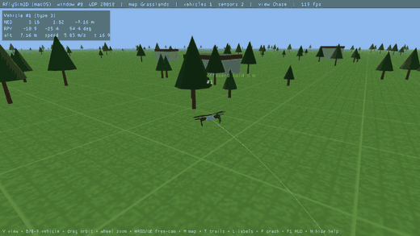
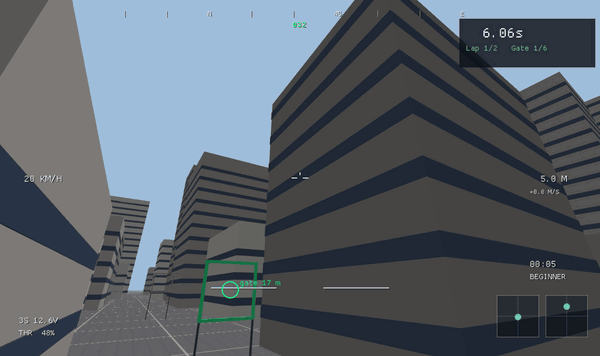
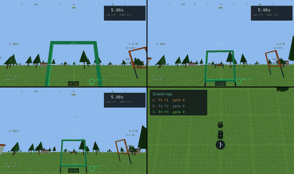

# RflySim tools for macOS and Linux

RflySim's RflyTools (CopterSim, RflySim3D/3DDisplay, SITLRun, HITLRun, Python38Env, FlightGear-F450) rebuilt
for **macOS and Linux**, in Rust plus a little Python. No MATLAB needed. It uses the same UDP and MAVLink
protocols as Windows RflySim, so PX4 and RflySimSDK-style Python scripts work unchanged. Also included:
**RflyGame**, an FPV drone game on the same flight physics.

| PX4 SITL flight in the RflySim3D-compatible viewer | RflyGame: FPV race | RflyGame: split screen |
|---|---|---|
|  |  |  |

How it compares with the original Windows RflySim (with a screenshot of the original CopterSim):
**[docs/COMPARISON.md](docs/COMPARISON.md)**. Full-length videos are in [docs/media](docs/media).

| RflyTools (Windows) | Replacement here | How to start (after installing) |
|---|---|---|
| CopterSim | `coptersim` (Rust) | started by SITLRun/HITLRun, or `coptersim --help` |
| RflySim3D (UE4) | `rflysim3d` (Rust, same UDP protocol) | `rflysim3d [--map City]` |
| 3DDisplay | `rflysim3d` | same |
| SITLRun | `rfly-sitlrun [N] [--qgc]` (`scripts/SITLRun.sh`) | N × (coptersim + PX4 SITL) + RflySim3D |
| HITLRun | `rfly-hitlrun [PORT…]` (`scripts/HITLRun.sh`) | Pixhawk(s) in HIL mode + RflySim3D |
| Python38Env | `rfly-python [script.py]` (`scripts/Python38Env.sh`) | venv + RflySimSDK port (`PX4MavCtrlV4`, `UE4CtrlAPI`, `VisionCaptureApi`) |
| FlightGear-F450 | `rfly-flightgear` + `coptersim --fg` | needs FlightGear + FGData |
| (game) | **RflyGame**: FPV racing, missions, flight school, multiplayer, garage. See [docs/RFLYGAME.md](docs/RFLYGAME.md) | `rflygame`, or the RflyGame app |
| (Simulink) | bdsim block diagrams: `python/examples/bd_position_control.py` | `coptersim --ext` + Python38Env |
| QGroundControl | official QGC for macOS/Linux | `--qgc` flag of SITLRun |
| Win10WSL | not needed: PX4 builds natively on macOS and Linux | `make px4_sitl_default` |
| eclipse | not needed: use VS Code | |

Not affiliated with RflySim. This project reimplements RflySim's public protocols; it contains no RflySim
code or data (see [RflySim data](#rflysim-data)).

## Install

Download a package from the [Releases page](https://github.com/Dankwa-Wadie/rflysim-mac-linux/releases):

| System | Package | Installs |
|---|---|---|
| macOS 11+ (Apple Silicon or Intel) | `RflyTools-VER-macOS.pkg` | apps in `/Applications/RflyTools`, tools in `/Library/RflyTools`, commands in `/usr/local/bin` |
| Debian / Ubuntu (x86_64, arm64) | `rflytools_VER_amd64.deb` / `_arm64.deb` | `sudo apt install ./rflytools_*.deb`: `/opt/rflytools`, app-menu entries, commands in `/usr/bin` |
| Other Linux | `rflytools-VER-linux-ARCH.tar.gz` | unpack anywhere, run `./install.sh` (per user: app menu + `~/.local/bin`) |

The macOS package is not notarized yet. If macOS blocks it, right-click it and choose Open, or click
*Open Anyway* in System Settings → Privacy & Security. Uninstall: `sudo /Library/RflyTools/uninstall.sh`
(macOS), `sudo apt remove rflytools` (Debian/Ubuntu), `./install.sh --uninstall` (tarball).

Commands after installing: `coptersim`, `rflysim3d`, `rflygame`, `rflygame-server`, `rfly-sitlrun`,
`rfly-hitlrun`, `rfly-python` (Python38Env), `rfly-flightgear`, `rfly-import-data`, `rfly-update`.

### Keeping RflyTools up to date

Once a day the tools check GitHub for a newer release. When there is one, RflyGame's menu shows *Update to
RflyTools X*, RflySim3D's status bar and the command-line tools print a notice. Nothing installs by itself:

```sh
rfly-update            # show what is new and install it (asks first; macOS asks for your password)
rfly-update --check    # just check
rfly-update --disable  # turn the daily check off (or RFLY_NO_UPDATE_CHECK=1); --enable turns it back on
```

On Debian/Ubuntu the `.deb` also adds the RflyTools APT repository, so `sudo apt upgrade` updates it like any
other package. Every update is signed: `rfly-update` installs only files whose checksums carry the RflyTools
release signature, and apt checks the repository's signature. (Versions before 0.2.0 have no updater: install
the new package once by hand.) How releases are made: [docs/RELEASING.md](docs/RELEASING.md).

### RflySim data

Two RflySim files make some features complete: `ModelData.db` (vehicle presets and the parts catalog
used by RflyGame's Garage) and RflySim's F450 FlightGear model. They belong to RflySim, so they are not
in this repository or the packages. Import them once from your own RflySim installer ISO
(`RFLYExpPspSoftwarePack.iso`):

```sh
rfly-import-data ~/Downloads/RFLYExpPspSoftwarePack.iso     # or open "Import RflySim Data"
scripts/import_rflysim_data.sh PATH                         # from a source checkout
```

It also accepts the ISO's `4.HILApps/CopterSim.zip`, `FlightGear 2016.1.2.zip` or an unpacked RflySim
folder. Without the import, everything else works: coptersim uses built-in F450 parameters and RflyGame
its built-in drones.

### PX4 SITL

SITLRun needs PX4 SITL (tested with v1.17.0) in `~/tools/PX4-Autopilot`, or pass `--px4 DIR`:

```sh
git clone --recursive --depth 1 -b v1.17.0 https://github.com/PX4/PX4-Autopilot ~/tools/PX4-Autopilot
cd ~/tools/PX4-Autopilot && make px4_sitl_default    # see PX4's docs for its build dependencies
```

## Build

```sh
cargo build --release      # coptersim, rflysim3d
cargo test --workspace     # unit tests
scripts/package.sh         # installer for this OS (macOS .pkg, or Linux .deb + .tar.gz)
scripts/package.sh --linux # on a Mac: Linux packages for amd64 + arm64 in Docker (colima --vz-rosetta)
```

PX4 SITL (tested with v1.17.0): `cd PX4-Autopilot && make px4_sitl_default`. SITLRun looks for it in
`~/tools/PX4-Autopilot` (override with `--px4 DIR` or `PX4_DIR`).

## Linux

Everything except the macOS `.app` bundles also runs on Linux (tested on Debian 12, x86_64/arm64).
The same scripts work on both systems.

```sh
# Debian/Ubuntu build dependencies (Fedora: systemd-devel alsa-lib-devel; Arch: systemd-libs alsa-lib)
sudo apt install build-essential pkg-config libudev-dev libasound2-dev libgl1 libx11-6 libxi6 libxkbcommon0 python3-venv
cargo build --release
scripts/build_apps.sh            # RflyTools/*.desktop launchers + app-menu entries
scripts/package_rflygame.sh      # dist/RflyGame-linux-<arch>.tar.gz
```

| Tool | Linux notes |
|---|---|
| RflySim3D / RflyGame | Need OpenGL 2.1+ on X11 or XWayland. RflyGame saves to `~/.local/share/rflygame`. |
| SITLRun `--qgc` | Finds QGroundControl on `PATH`, as `QGroundControl*.AppImage` in `~`, `~/Applications`, `~/tools` or `~/Downloads`, or via `QGC_BIN`. |
| HITLRun | Pixhawk ports default to `/dev/ttyACM*`. Add yourself to `dialout` (`sudo usermod -aG dialout $USER`), and stop ModemManager if it grabs the port. |
| FlightGear-F450 | `sudo apt install flightgear`. The script finds `fgfs` and `/usr/share/games/flightgear` itself. |
| Gamepads | Your user needs read access to `/dev/input/event*` (the `input` group on some distros). |

`scripts/linux_docker_test.sh` builds and runs all of `test_all.sh` in a Debian container under a virtual display,
including PX4 SITL (built once for Linux from `~/tools/PX4-Autopilot`). Use it to check Linux from a Mac
(needs a Docker engine such as colima: `colima start`).

## Typical session

```sh
scripts/SITLRun.sh 1 --qgc                                     # sim + PX4 + RflySim3D + QGC
scripts/Python38Env.sh python/examples/offboard_camera.py      # RflySimSDK-style experiment
```

RflySim3D keys: V view · B / 0-9 vehicle · mouse drag orbit · wheel zoom · WASD/QE free camera ·
M map · T trails · L labels · P crash detection · H help.

## Tests

```sh
scripts/test_all.sh                              # everything below + SITL/Python/bdsim/apps (~4 min)
cargo test --workspace
python3 scripts/test_rflysim3d.py                # with rflysim3d running: protocol + image stream
scripts/e2e_px4_sitl.sh ~/tools/PX4-Autopilot    # automated takeoff/hover/land with real PX4
```

## Layout

| Path | Purpose |
|---|---|
| `crates/rfly-core` | Physics + sensor models, no dependencies |
| `crates/rfly-db` | Reads vehicle presets from RflySim's `ModelData.db` |
| `crates/rfly-proto` | RflySim UDP wire formats (CopterSim / RflySim3D / SDK) |
| `crates/coptersim` | Simulator: PX4 MAVLink link, RflySim3D + true-data outputs, FlightGear, HIL relay |
| `crates/rflysim3d` | RflySim3D-compatible viewer (macroquad): maps, vehicles, cameras over UDP |
| `python/RflySimSDK_mac` | macOS ports of the RflySimSDK Python modules |
| `python/rflyctl` | Lockstep client, controllers, bdsim blocks (Simulink-style design) |
| `crates/rflygame` | RflyGame (game, `rflygame-server`) |
| `RflyTools/` | `.app` bundles with icons (`scripts/build_apps.sh`) |
| `matlab/RflyMac` | Optional MATLAB/Simulink package |

See [PROGRESS.md](PROGRESS.md), [docs/RFLYSIM3D_PROTOCOL.md](docs/RFLYSIM3D_PROTOCOL.md) and
[docs/RE_FINDINGS.md](docs/RE_FINDINGS.md).
