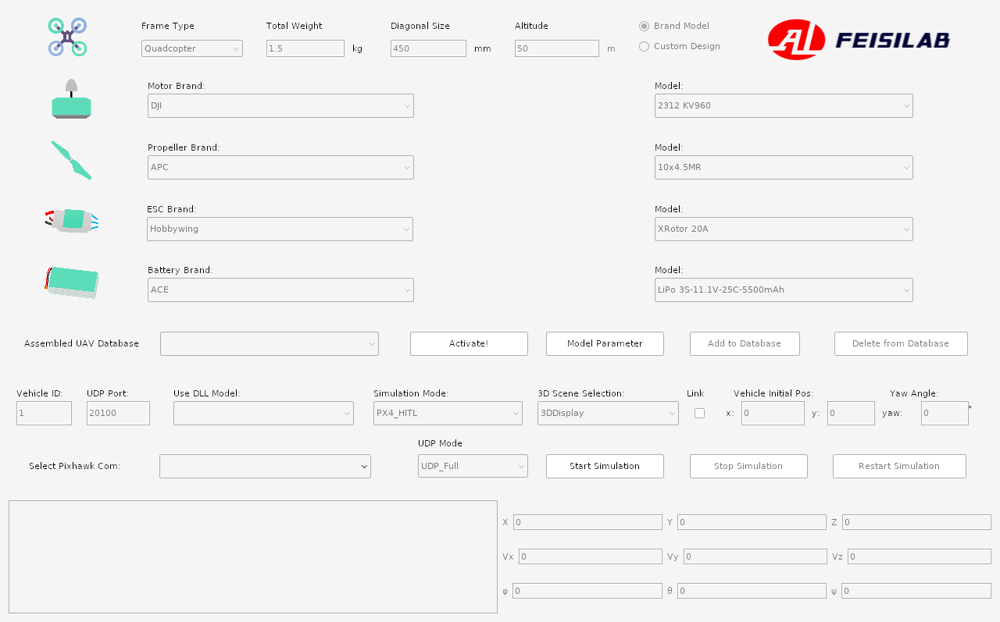
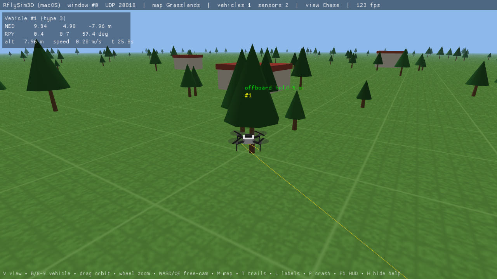
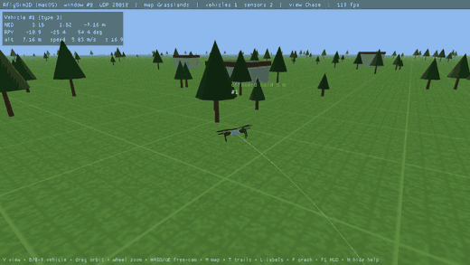
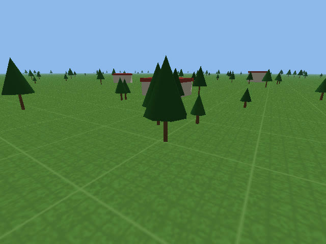
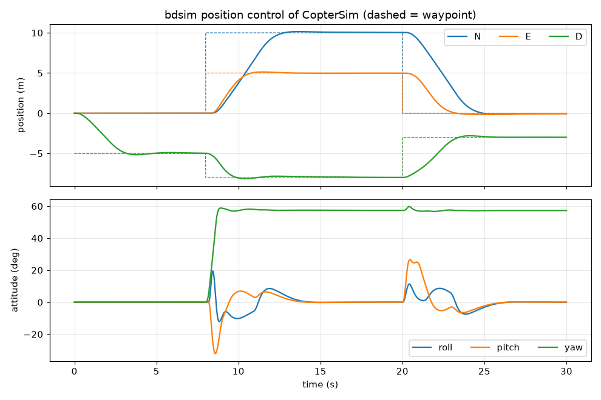
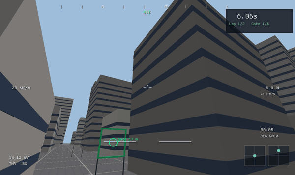
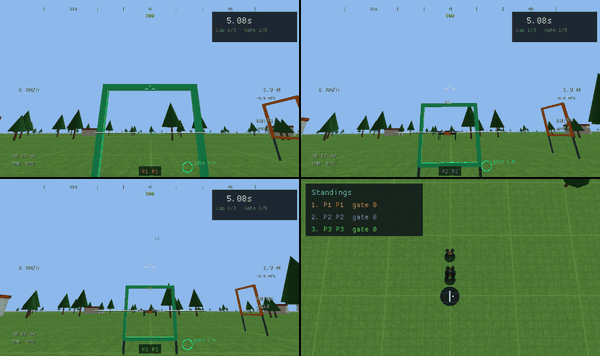

# RflyTools for macOS/Linux vs. the original Windows RflySim

RflySim is a Windows toolchain for multicopter design and testing with PX4: CopterSim (simulator),
RflySim3D/3DDisplay (3D views), SITL/HIL launchers, a Python SDK and MATLAB/Simulink support. This
project rebuilds those tools for macOS and Linux. It speaks the same UDP and MAVLink protocols, so
RflySimSDK-style Python scripts and PX4 work unchanged. It contains no RflySim code or data.

## At a glance

| | RflySim (Windows, original) | RflyTools (this project) |
|---|---|---|
| Systems | Windows 10/11 x64 | macOS 11+ (Apple Silicon and Intel), Linux x86_64 and arm64 |
| Download / install | 3.9 GB installer ISO, plus MATLAB for the PSP | 11 MB `.pkg` (macOS), ~3 MB `.deb` / ~6 MB `.tar.gz` (Linux) |
| Activation | Serial-number licence | None (MIT) |
| PX4 | Bundled 1.7.3 / 1.8.2 source, built with MSYS2 or WSL | Upstream PX4 (tested v1.17.0), built natively |
| MATLAB | Needed for the PSP and Simulink workflows | Not needed. Python block diagrams (bdsim); optional RflyMac Simulink package |
| Simulator | CopterSim: Qt5 GUI with vehicle configurator | `coptersim`: headless, same ports and parameters (reads RflySim's ModelData.db) |
| 3D view | RflySim3D (Unreal Engine 4) and 3DDisplay (Ogre3D) | `rflysim3d`: lightweight viewer with the RflySim3D UDP protocol |
| Python SDK | RflySimSDK (Python 3.8, Windows) | `RflySimSDK_mac`: `PX4MavCtrlV4`, `UE4CtrlAPI`, `VisionCaptureApi` subset |
| Extras | | RflyGame (FPV game: racing, missions, flight school, multiplayer); FlightGear output; Linux `.deb` |

## CopterSim

| Original (Windows, shown under Wine) | This project |
|---|---|
|  |  |
| Qt5 window: pick motor, propeller, ESC and battery from the catalog, then *Start Simulation* in HITL/SITL mode. | `coptersim` runs headless next to PX4 (`rfly-sitlrun N` starts N vehicles plus the viewer). The same catalog drives RflyGame's Garage. |

The left screenshot is RflySim's own CopterSim.exe from the RflySim ISO, running under Wine 8 in a Linux
container on a Mac (© its authors; shown for comparison). It loads RflySim's ModelData.db and shows the
default DJI F450 setup.

What `coptersim` does the same way:
- PX4 SITL over TCP 4560+N with lockstep, HIL over a Pixhawk's USB serial, QGroundControl on UDP 14550.
- RflySim's ports: vehicle state to RflySim3D on 20010+, true state on 30101+2(N−1), MAVLink for Python on 20100+2(N−1).
- Vehicle parameters from RflySim's `ModelData.db` (default F450: mass 1.4 kg, Ct, Cm, motor curve). PX4 hovers at
  throttle 0.61, against the model's prediction of 0.608.
- An external-controller lockstep port (20100) for MATLAB/Simulink or Python controllers.

What differs:
- No configurator window. The Windows GUI's catalog and drone builder live in RflyGame's Garage, and
  `coptersim --db/--params` selects parameter sets.
- Physics covers quadcopters. The viewer draws hexa, octo, plane and car, but there are no hexa/octo dynamics yet.
- No model-DLL plug-in (`Simulink&DLL_SIL`), which is also unavailable in the free Windows build.

## RflySim3D / 3DDisplay

| PX4 SITL flight in `rflysim3d` (macOS) | Camera image a Python script received |
|---|---|
|  |  |

Full clip: [rflysim3d_px4_sitl.mp4](media/rflysim3d_px4_sitl.mp4). PX4 v1.17 flies an offboard mission
sent by `python/examples/offboard_camera.py` through the RflySimSDK-style API: take off to 5 m, move to
(10, 5, −8), land. The script asks the viewer for RGB and depth cameras with the same `VisionCaptureApi` calls
it would use on Windows.

- **RflySim3D** is RflySim's Unreal Engine 4 program, with photorealistic scenes. It is not on the RflySim ISO
  (it ships separately), so it could not be shown here; see RflySim's own site and videos. `rflysim3d`
  implements its UDP protocol (vehicle updates, map/camera/label commands, object queries, crash reports,
  RGB/depth/grey/segmentation image streams), as documented in [RFLYSIM3D_PROTOCOL.md](RFLYSIM3D_PROTOCOL.md).
  It draws simple procedural scenes (Grasslands, City, Desert, Blank, VisionRingBlank) instead of UE4 levels.
- **3DDisplay** is the older Ogre3D viewer. It is a 32-bit Windows program, which Wine cannot run on Apple
  Silicon (Rosetta's Linux mode runs only 64-bit x86), so it is not shown either. `rflysim3d --map Blank` takes
  its place.

## Simulink → Python block diagrams



On Windows, controllers are designed in Simulink and tested against CopterSim. Here the same loop is a
`bdsim` block diagram (`python/examples/bd_position_control.py`): COPTERSIM, POSCTRL, ATTCTRL and WAYPOINTS
blocks run on one 250 Hz clock against `coptersim --ext`. It simulates 30 s of flight in 0.7 s, or in real time
with the vehicle in `rflysim3d`. MATLAB users can use the RflyMac Simulink block instead (`matlab/RflyMac`).

## RflyGame (new)

| FPV, City Slalom | Split screen, 3 pilots |
|---|---|
|  |  |

Full clips: [FPV City Slalom](media/rflygame_fpv_city.mp4), [chase camera, Raceway GP](media/rflygame_raceway.mp4),
[split screen](media/rflygame_split.mp4). All recorded from the game's own frames (`RFLY_RECORD=DIR`), flown by the
built-in test autopilot. RflyGame uses the same flight physics and RflySim's F450 parameters, so practice in
the game carries over to the simulator. See [RFLYGAME.md](RFLYGAME.md).

## Recording your own clips

```sh
RFLY_RECORD=/tmp/frames RFLY_RECORD_SECS=20 rflysim3d        # also works for rflygame
ffmpeg -framerate 30 -i /tmp/frames/f%06d.jpg -pix_fmt yuv420p clip.mp4
```

`RFLY_RECORD_FPS` (default 30) and `RFLY_RECORD_AFTER` (seconds to wait first) tune it. Only the app's own
frame is captured, never the rest of the screen.
